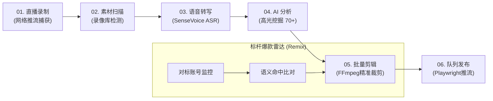

# VideoScreen - 全自动直播智能切片与发布系统

<p align="center">
  
  
  
  
  
  
  
  
</p>

**VideoScreen** 是一套专为内容创作者、MCN 机构和切片工作室设计的**全自动化直播切片与发布系统**。系统贯穿**「直播多机位录制 ➔ 语音高精转写 ➔ AI 高光挖掘 ➔ 毫秒级批量切片 ➔ 标杆爆款跟剪 ➔ 自动化批量发布」**全链路闭环，支持无人值守挂机批量出片。

同时提供 **macOS 原生设计规范（HIG）桌面端** 与 **Web 响应式控制台**，既能原生离线运行，也可部署于团队服务器。

---

## 🌟 核心特性

- 🔴 **全自动直播监控与多平台录制**
  - 内置直播录制服务，支持抖音、快手、TikTok、虎牙、斗鱼等多平台。
  - 主播开播自动嗅探推流并高码率分段录制，下播自动封包，录制状态毫秒级实时感知。

- 🎙️ **SenseVoice 离线毫秒级高精度转写**
  - 基于阿里开源 SenseVoice-Small 工业级语音识别模型，纯离线 GPU/CPU 加速运行，数据不出本地。
  - 输出包含严格时间戳的字幕文本（支持情感标记、纯净过滤与同音纠错）。

- 🧠 **AI 语义分析与高光价值挖掘**
  - 无缝对接本地 **Ollama**（Qwen2.5 / Llama 3 / DeepSeek-R1）或云端大模型 API（DeepSeek / 通义千问 / 硅基流动）。
  - 多维度打分引擎（观点犀利度、逻辑完整性、信息密度、金句爆发力），自动过滤废话、口癖与带货杂音，智能截取黄金切片区间。

- ✂️ **FFmpeg 极速精准无损剪辑**
  - 毫秒级关键帧无损提取，杜绝二次重编码造成的画质劣化。
  - 自动对齐音频音轨，支持全自动原素材空间释放与成片归档。

- 🎯 **标杆爆款雷达与秒级同款跟剪**
  - 实时追踪对标大号的爆款选题与点赞爆发增速。
  - 秒级语义检索全素材库同款原声片段，一键跟剪出片；支持外部视频链接一键二次创作入库。

- 🚀 **Playwright 驱动全自动化发布与文案反哺**
  - 自动调用无头/有头浏览器对接创作者中心，自动填写标题、文案、标签与合集。
  - 自动选取推荐封面、勾选自主声明，支持发布频率智能风控与发布后流量回访归因。

---

## 🏗️ 系统全流程流水线架构



---

## 🖥️ 双端交互界面

### 1. macOS HIG 原生专业桌面端 (`desktop_app.py`)
- 严格遵循 Apple Human Interface Guidelines 规范，采用纯净 SF Pro 排版、微质感卡片与紧凑胶囊分段标签栏。
- 完整涵盖：**概览工作台、直播录制、素材管理、AI 候选、成片发布、账号雷达、系统设置** 7 大模块。

### 2. 现代 Web 响应式控制台 (`dashboard_server.py`)
- 轻量级异步 Web 服务，支持局域网内任意手机、平板或浏览器直接访问。
- 具备实时日志流推送、视频在线播放比例切换（16:9 / 9:16 / 自由铺满）、文案实时编辑等功能。

---

## 🚀 快速上手

### 环境准备

- **操作系统**：Linux (Ubuntu 20.04+ 推荐) / macOS (Apple Silicon 最佳) / Windows (WSL2)
- **Python**：3.10+
- **系统核心依赖**：
  ```bash
  # Ubuntu / Debian
  sudo apt-get update && sudo apt-get install -y ffmpeg libgl1-mesa-glx
  ```

### 1. 克隆代码仓库

```bash
git clone https://github.com/your-username/VideoScreen.git
cd VideoScreen
```

### 2. 创建虚拟环境并安装依赖

```bash
# 推荐使用 conda 或 venv
conda create -n video-screen python=3.10 -y
conda activate video-screen

# 安装依赖
pip install -r requirements.txt

# 安装 Playwright 浏览器内核 (用于自动化发布)
playwright install chromium
```

### 3. 配置系统参数

复制示例配置文件并根据需求调整：

```bash
cp config.example.json config.json
```

在 `config.json` 中配置你的 AI 模型后端（默认支持 Ollama 本地模型）：
```json
{
  "mode": "hybrid",
  "min_score": 70,
  "ai": {
    "provider": "ollama",
    "ollama": {
      "base_url": "http://127.0.0.1:11434",
      "model": "qwen2.5:7b"
    }
  }
}
```

### 4. 启动系统

#### 方式 A：启动 macOS 极简原生桌面客户端
```bash
./start_gui.sh
# 或直接运行：python desktop_app.py
```

#### 方式 B：启动 Web 网页版控制台
```bash
./start_dashboard.sh
# 浏览器访问：http://127.0.0.1:8780
```

#### 方式 C：纯命令行挂机与单工序执行
```bash
# 1. 扫描新录像
python video_screen.py scan

# 2. 批量转写录像
python video_screen.py batch

# 3. AI 分析与高光提取
python analyze_videos.py

# 4. 批量剪辑出片
python prepare_clips.py

# 5. 全自动流水线 (一键执行全部步骤)
python video_screen.py auto
```

---

## 📂 项目结构说明

```text
VideoScreen/
├── desktop_app.py            # macOS 原生风格 PyQt5 桌面客户端主程序
├── dashboard_server.py       # Web 控制台后端服务 (HTTP API / 任务调度)
├── dashboard_static/         # Web 控制台前端静态资源 (HTML / CSS / JS)
│   ├── index.html
│   ├── style.css
│   └── enhancements.css
├── video_screen.py           # 核心控制总线 (扫描/转写调度/流水线驱动)
├── analyze_videos.py         # AI 高光语义分析与评分挖掘模块
├── prepare_clips.py          # FFmpeg 批量剪辑切片执行引擎
├── publish_assistant.py      # 短视频智能发布文案生成引擎
├── douyin_web_uploader.py    # Playwright 网页自动化发布模块
├── benchmark_radar.py        # 标杆爆款监控与同款跟剪雷达引擎
├── remix_service.py          # 外部视频二次创作与混剪服务
├── live_recorder/            # 直播全自动录制服务组件 (基于 DouyinLiveRecorder)
├── live_recorder_service.py  # 录制服务生命周期管理器 (启动/停止/日志监控)
├── start_gui.sh              # 桌面客户端一键启动脚本
├── start_dashboard.sh        # Web 控制台一键启动脚本
├── config.example.json       # 系统配置模板示例
├── requirements.txt          # Python 核心依赖清单
├── LICENSE                   # 开源许可协议 (MIT)
└── README.md                 # 项目详细说明文档
```

---

## ⚙️ 进阶配置与技巧

### 1. 监控词与领域词权重加成
在 `config.json` 的 `keywords` 与 `keyword_weights` 中自定义你的关注词（如人名、特定行业术语或热门梗）。AI 在挖掘高光时会对命中核心词的片段予以优先保留和权重加分。

### 2. 磁盘空间自动瘦身
直播原片体积较大，已剪辑完成的素材可通过界面中的 **「清理已剪原片」** 按钮一键物理删除，原始字幕文本、AI 候选数据与最终高清成片将完好保留。

---

## 🤝 贡献与反馈

欢迎提交 Issue 和 Pull Request！如果你在部署或使用过程中有任何疑问，请提交反馈。

## 📄 开源许可证

本项目基于 [MIT License](LICENSE) 协议开源。

