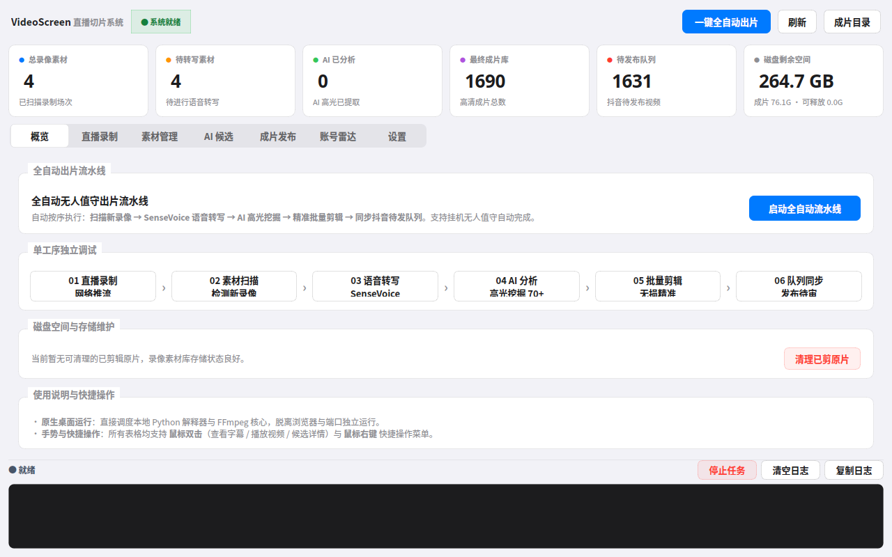
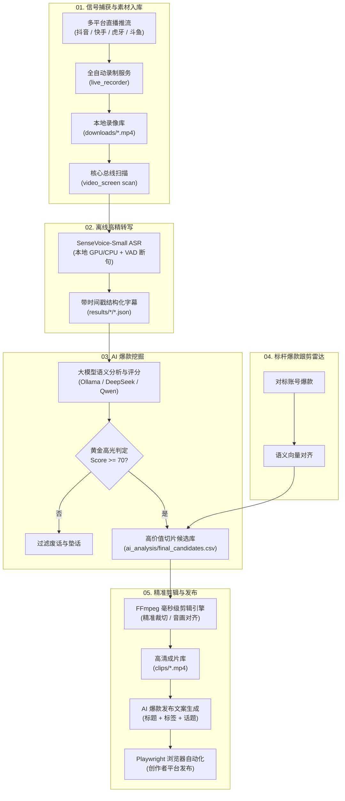
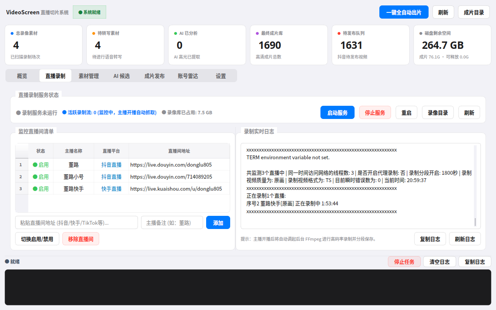
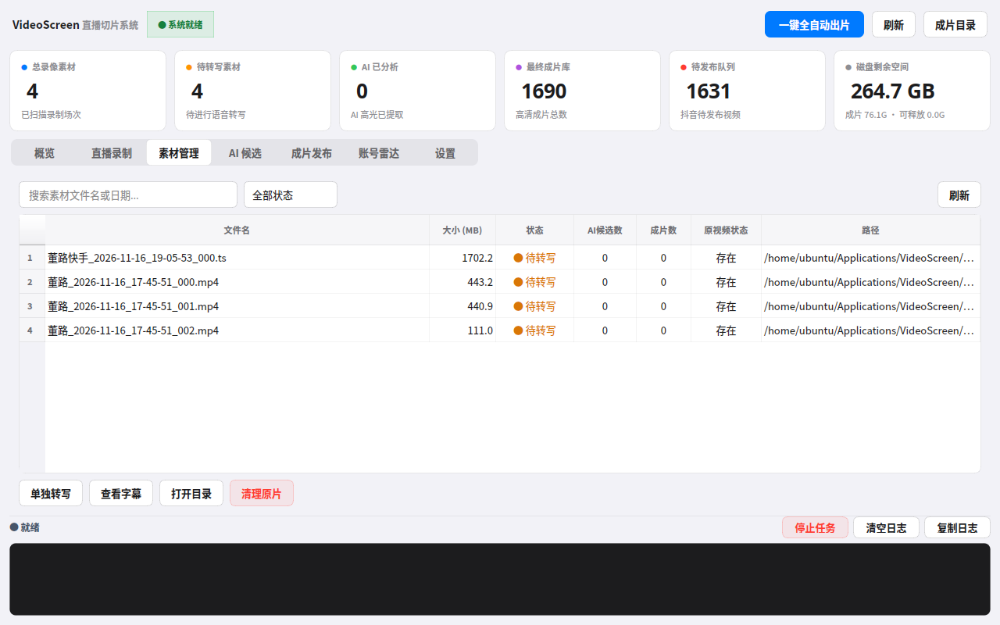
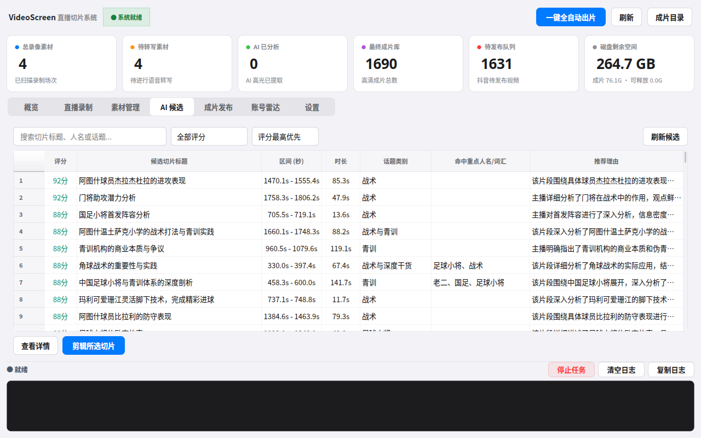
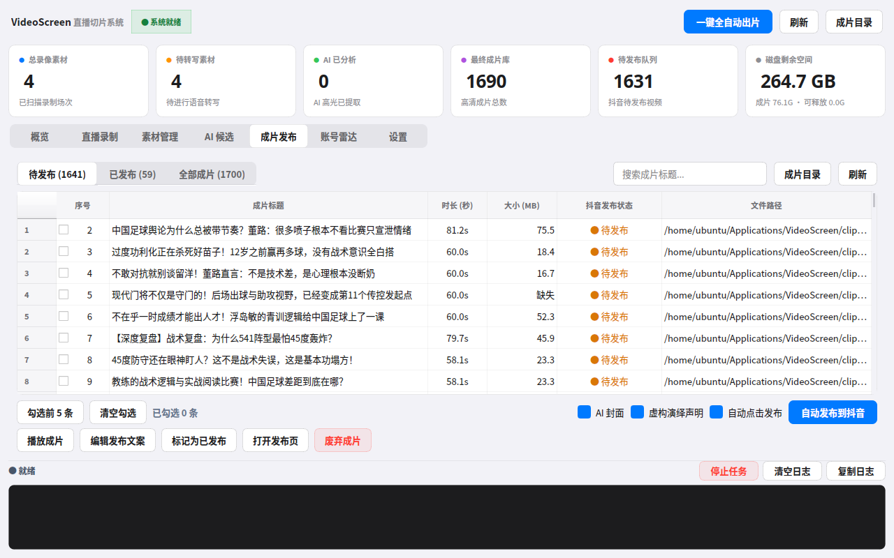
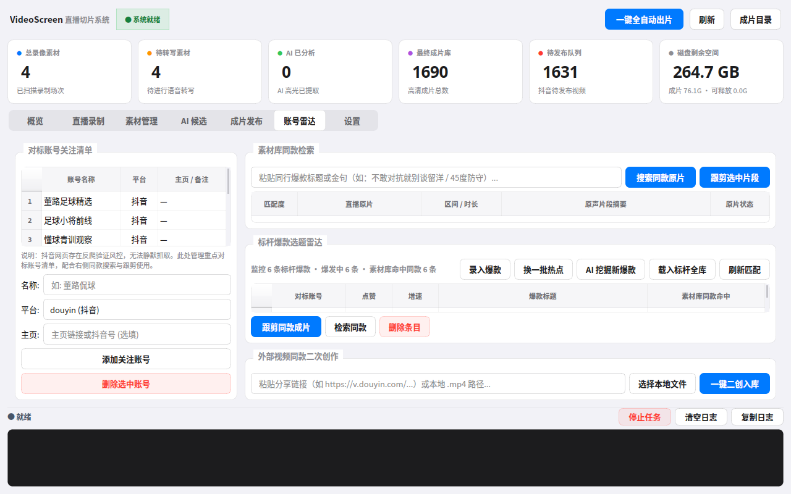
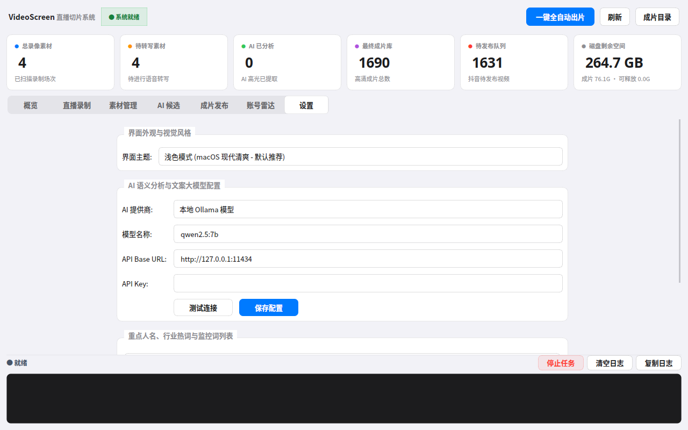

# VideoScreen - 全自动直播智能切片与发布系统

<p align="center">
  
  
  
  
  
  
  
  
</p>

---

## 📖 项目简介

**VideoScreen** 是一套专为自媒体创作者、MCN 机构和切片工作室打造的**全自动化直播录制、智能切片与发布一体化桌面系统**。

系统打通了从推流监测到成品发布的全链路闭环：
> **「多平台无人值守录制 ➔ SenseVoice 离线高精语音转写 ➔ 大模型深度语义价值挖掘 ➔ FFmpeg 毫秒级无损剪辑 ➔ 标杆爆款跟剪二次创作 ➔ Playwright 自动化批量发布」**

前端界面严格遵循 **Apple macOS Human Interface Guidelines (HIG)** 设计哲学，采用 PyQt5 打造纯净专业的原生桌面应用，彻底脱离浏览器与 Web 端口依赖，保障数据本地私密与极速响应。

<p align="center">
  
</p>

---

## 🌟 核心特性

- 🔴 **全自动直播监控与多平台录制**
  - 内置直播录播服务，支持抖音、快手、TikTok、微信视频号、虎牙、斗鱼等多主流平台。
  - 主播开播秒级自动嗅探、多码率推流分段录制、断流重连与下播自动封包。

- 🎙️ **SenseVoice 工业级离线语音转写**
  - 基于阿里开源 **SenseVoice-Small** 模型与高效 VAD 语音断句，纯本地 GPU / CPU 离线高速运行，零网络请求、数据不出本地。
  - 精确输出带字级、句级时间戳的结构化字幕文本，自动过滤废话杂音，具备高精度同音错别字纠错能力。

- 🧠 **大模型深度语义分析与高光打分挖掘**
  - **多模型无缝切换**：原生支持本地 **Ollama**（Qwen2.5 / DeepSeek-R1 / Llama 3）及主流云端 API（DeepSeek / 通义千问 / 硅基流动）。
  - **多维黄金标准打分**：从观点犀利度、逻辑完整性、信息密度、金句爆发力四重维度自动评级（默认 70+ 分保留），自动过滤垫话、客套与商业杂质，智能定位高光起止区间。

- ✂️ **FFmpeg 毫秒级精准无损剪辑**
  - 基于关键帧微调与智能编码剪裁，毫秒级切割，杜绝画面卡顿与黑帧，保持原始画质与音画严格同步。
  - **智能空间瘦身**：支持原片物理清理功能，剪辑完成后可一键释放数十 GB 原录像磁盘空间，而转写文本、AI 候选数据与最终高清成片完好保留。

- 🎯 **标杆爆款雷达与跟剪二创**
  - 实时监控对标账号爆款选题与爆点热度。
  - 秒级语义检索全素材库同款原声片段，一键跟剪出片；支持外部视频链接一键二次创作与智能混剪。

- 🚀 **Playwright 驱动全自动化发布引擎**
  - 驱动原生浏览器对接短视频创作者中心，全自动上传视频、填写爆款标题、精炼文案、热门标签与作品合集。
  - 智能抓取优质推荐封面，支持多账号轮巡、防封控发布间隔延时与全自动无人值守排期。

- 🎨 **macOS HIG 专业原生桌面美学 & 桌面一键启动**
  - 纯净优雅的 Apple 现代设计美学：微质感卡片、胶囊分段导航、动态自适应布局与非阻塞异步多线程架构，操作流畅顺滑。
  - **开箱即用桌面快捷方式**：内置一键安装脚本 `install_desktop_shortcut.sh`，自动配置 macOS Squircle 高清拟态图标，秒级注册到操作系统应用程序菜单与电脑桌面，双击即启。

---

## 🏗️ 系统全流程架构拓扑



---

## 📸 桌面客户端核心功能与界面展示 (UI Showcase)

### 1. 📊 概览工作台 (Overview)
- **大盘指标全局掌握**：总录像场次、待转写素材、AI 高光已提取数、高清成品库总数、待发布队列与磁盘剩余空间。
- **全流程一键流水线**：一键自动化驱动「素材扫描 ➔ 离线转写 ➔ AI 高光挖掘 ➔ 批量切片出片」全链路，无需人工值守。
- **磁盘智能瘦身**：一键安全物理清理已剪辑的原视频大文件，完好保留字幕数据与最终高清成片，节省 90%+ 硬盘空间。

<p align="center">
  
</p>

---

### 2. 🔴 直播录制 (Live Recorder)
- **多平台智能嗅探**：支持抖音、快手、TikTok、微信视频号、虎牙、斗鱼等多平台多房间开播秒级监听。
- **录像生命周期自控**：开播自动分段推流抓取，断流重连与下播自动归档，内置录制终端控制台日志实时查看。

<p align="center">
  
</p>

---

### 3. 📁 素材管理 (Sources & ASR)
- **结构化录像资产库**：实时监控所有录像文件的大小、时长、转写状态与录制时间。
- **SenseVoice 工业级批量转写**：纯离线 GPU/CPU 极速转写，带字级高精时间戳与自动 VAD 停顿切分，数据 100% 本地私密。

<p align="center">
  
</p>

---

### 4. 🧠 AI 候选挖掘 (AI Candidates)
- **大模型爆款语义提炼**：自动过滤口癖、垫话与废话，打分算法精准提取观点犀利、金句爆发的黄金切片。
- **起止区间与观点摘要**：清晰显示每个切片的起止时间戳、时长、综合评分与高光原因剖析，支持单选/批量切片。

<p align="center">
  
</p>

---

### 5. 🎬 成片库与自动化发布 (Clips & Publishing)
- **内置播放器与多比例切换**：支持 16:9 宽屏、9:16 竖屏及自由铺满屏幕模式，即剪即看。
- **AI 爆款发布文案生成**：一键生成吸引点击的爆款标题、文案正文与精准垂直标签。
- **Playwright 全自动或半自动发布**：直接驱动浏览器对接创作者平台，支持多视频队列批量发布与发布后数据回访。

<p align="center">
  
</p>

---

### 6. 🎯 标杆爆款雷达 (Benchmark Radar)
- **竞对同款一键跟剪**：监控对标创作者热门爆款视频，全素材库秒级语义搜索同款原声原片，迅速跟剪入库。
- **外部视频二次创作**：支持输入视频链接提取音频与字幕，进行多机位或片段智能二次混剪。

<p align="center">
  
</p>

---

### 7. ⚙️ 系统设置 (Settings)
- **大模型灵活自由切换**：支持 Ollama 本地私有化模型（Qwen2.5 / DeepSeek-R1 / Llama 3）或公有云高性价比 API。
- **重点人名与行业热词加权**：自定义人名、业务关键词与权重倍率，精准命中行业切片。

<p align="center">
  
</p>

---

## 🚀 快速上手

### 1. 环境准备

- **操作系统**：Linux (Ubuntu 20.04+ 推荐) / macOS (Apple Silicon 兼容) / Windows 11 (WSL2)
- **Python 版本**：Python 3.10 或更高
- **系统工具依赖**：
  ```bash
  # Ubuntu / Debian
  sudo apt-get update && sudo apt-get install -y ffmpeg libgl1-mesa-glx
  ```

### 2. 克隆代码仓库

```bash
git clone https://github.com/liuhao0318/VideoScreen.git
cd VideoScreen
```

### 3. 创建虚拟环境并安装依赖

推荐使用 Conda 隔离环境：

```bash
# 创建并激活 Python 3.10 环境
conda create -n video-screen python=3.10 -y
conda activate video-screen

# 安装项目核心依赖
pip install -r requirements.txt

# 安装 Playwright 自动化浏览器驱动内核
playwright install chromium
```

### 4. 准备 AI 大模型（以 Ollama 本地运行为例）

如果您选择纯本地私有化部署大模型，建议安装 [Ollama](https://ollama.com/) 并下载推荐模型：

```bash
# 启动 Ollama 服务并拉取推荐的通义千问 2.5 或 DeepSeek 模型
ollama pull qwen2.5:7b
# 或者：ollama pull deepseek-r1:7b
```

### 5. 初始化配置文件

复制系统配置模板：

```bash
cp config.example.json config.json
```

根据您的实际情况编辑 `config.json`（示例配置）：
```json
{
  "mode": "hybrid",
  "min_score": 70,
  "context_seconds": 90,
  "ai": {
    "provider": "ollama",
    "ollama": {
      "base_url": "http://127.0.0.1:11434",
      "model": "qwen2.5:7b"
    }
  },
  "keywords": [
    "高光",
    "金句",
    "干货",
    "名场面",
    "互动",
    "争议"
  ],
  "keyword_weights": {
    "高光": 1.5,
    "金句": 1.3,
    "干货": 1.2
  }
}
```

### 6. 配置桌面一键启动快捷方式（强烈推荐）

在项目根目录下执行自带的快捷方式安装器：

```bash
bash install_desktop_shortcut.sh
```

该脚本将自动完成：
1. 提取当前项目路径并动态绑定执行权限；
2. 为快捷方式关联 512x512 高清 Squircle 专属图标；
3. 将 **「VideoScreen 直播切片系统」** 注册至系统应用程序中心（`~/.local/share/applications/`）；
4. 在电脑桌面（`~/Desktop/`）生成可直接双击运行的桌面图标，并自动赋予 GNOME 信任标识。

---

## 💻 运行系统

### 方式一：电脑桌面双击启动（日常首选）

完成上述第 6 步配置后，直接在 Ubuntu / Linux 电脑桌面上**双击「VideoScreen 直播切片系统」图标**即可秒级唤醒应用，无需每次打开终端。

### 方式二：终端脚本或 Python 直接运行

```bash
# 方式 A：通过预置启动脚本一键启动（自动优选最适 Python 解释器）
./start_gui.sh

# 方式 B：通过 Python 直接运行
python desktop_app.py
```

### 方式三：纯命令行无人值守流水线（服务器挂机）

您也可以将脚本部署在没有图形界面的高性能服务器或云主机上，通过命令行进行单工序排期或全流程批量流水线作业：

```bash
# 步骤 1：扫描录制目录中新增的视频素材
python video_screen.py scan

# 步骤 2：执行 SenseVoice 离线批量语音转写
python video_screen.py batch

# 步骤 3：调用大模型进行语义分析与高光片段打分
python analyze_videos.py

# 步骤 4：驱动 FFmpeg 进行毫秒级关键帧切片出片
python prepare_clips.py --min-duration 60 --max-duration 600 --cut

# 步骤 5：批量自动化发布至创作者平台
python batch_publish.py
```

---

## 📂 项目结构说明

```text
VideoScreen/
├── desktop_app.py            # macOS 原生风格 PyQt5 专业桌面客户端主程序
├── core_service.py           # 核心业务总线服务 (数据聚合 / 任务调度 / 状态流转)
├── video_screen.py           # 视频素材扫描、ASR 离线转写调度引擎
├── analyze_videos.py         # AI 爆款语义挖掘、黄金高光区间打分引擎
├── prepare_clips.py          # FFmpeg 批量毫秒级精准切片执行引擎
├── publish_assistant.py      # 短视频智能发布文案/标签生成助手
├── douyin_web_uploader.py    # Playwright 创作者平台自动化发布驱动
├── benchmark_radar.py        # 标杆爆款数据监控与同款跟剪雷达引擎
├── remix_service.py          # 外部视频二次创作与混剪服务
├── live_recorder/            # 直播多平台自动录像底层组件 (基于 DouyinLiveRecorder)
├── live_recorder_service.py  # 录制服务生命周期管理器 (启动/停止/日志监控)
├── assets/                   # 高清应用矢量图标与图形资产
├── docs/images/              # 客户端功能模块高清界面预览图
├── VideoScreen.desktop       # Linux 桌面快捷方式启动器配置
├── install_desktop_shortcut.sh # 桌面一键启动安装配置脚本
├── start_gui.sh              # 桌面客户端一键启动运行脚本
├── config.example.json       # 系统脱敏配置模板
├── requirements.txt          # Python 依赖清单
├── LICENSE                   # 开源许可协议 (MIT)
└── README.md                 # 项目详细说明文档
```

---

## ⚙️ 实用技巧与最佳实践

### 1. 监控人名与业务热词加成
在 `config.json` 的 `keywords` 与 `keyword_weights` 中配置您的重点观察词汇（如嘉宾名字、特定行业术语、核心产品名）。AI 在进行语义初筛与精细打分时，命中关键词的片段会获得更高的权重加成并优先入选切片候选。

### 2. 磁盘空间快速瘦身
长时间多机位直播录像极度占用硬盘空间（单场动辄 5~20 GB）。系统采用**元数据持久化分离机制**，当视频剪辑为成片后，在桌面端点击 **「清理已剪原片」** 即可安全物理删除庞大原片，而转写文本、时间戳、AI 分析报告及最终的高清切片将完好保留，大幅节省 90% 以上的硬盘空间。

---

## 📄 开源许可证

本项目基于 [MIT License](LICENSE) 协议开源，欢迎自由使用、修改与衍生开发。
